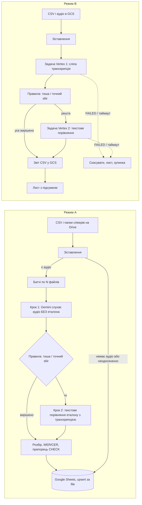
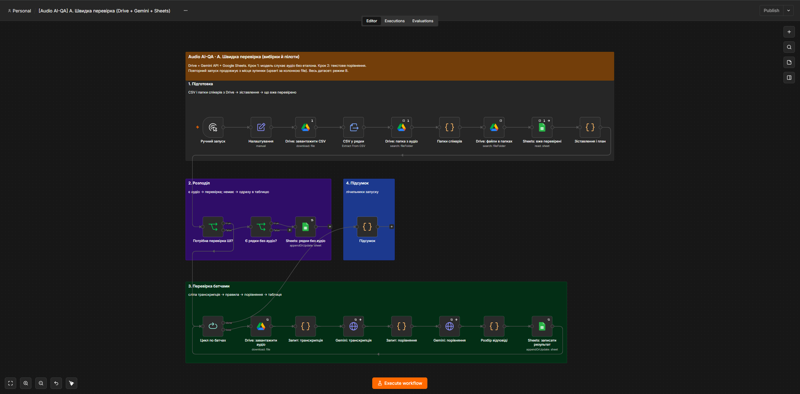
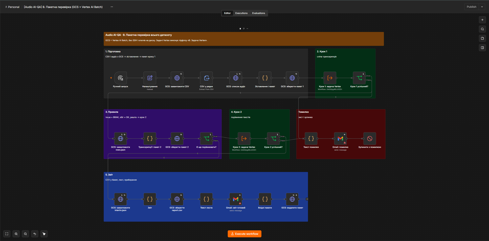
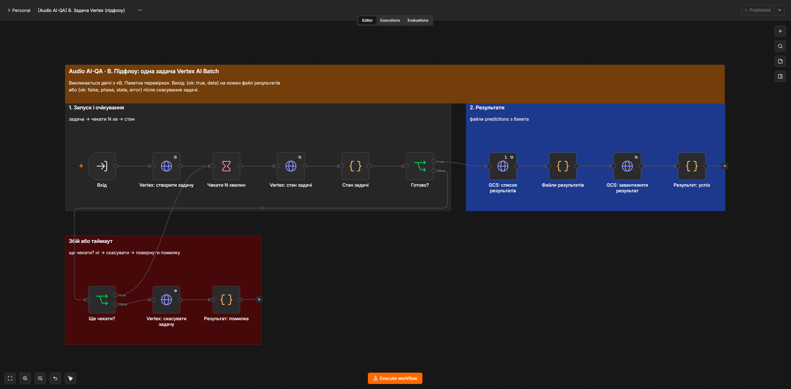
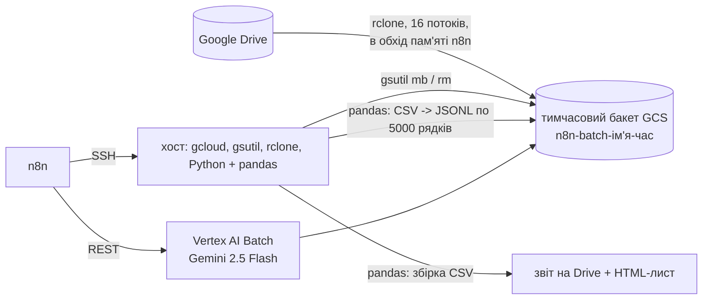

# Audio Dataset AI-QA

Автоматична перевірка якості транскрипцій у великих аудіодатасетах за допомогою Gemini на n8n.
Перевірка у два кроки: спершу модель **наосліп** транскрибує аудіо (еталон їй не показують), потім
текстовий запит порівнює еталон транскрибатора з цією транскрипцією і ставить вердикт
**OK / MINOR / BRAK** зі списком конкретних помилок. Код рахує WER/CER і позначає випадки, де
вердикт суперечить метриці. Сліпа транскрипція заразом є готовою підказкою для виправлення.

Проєкт виріс із двох робочих флоу, якими перевіряли датасет на ~154 тис. сегментів (~300 год,
три мови). Нинішня версія переписана після розбору реальних запусків: див. розділ «Що було не так».

## Два режими

| | A. Швидка перевірка | B. Пакетна перевірка |
|---|---|---|
| Флоу | `workflows/audio-qa-sync.json` | `workflows/audio-qa-batch-vertex.json` + підфлоу `audio-qa-vertex-job.json` |
| Для чого | вибірки, пілоти, сотні або тисячі файлів | увесь датасет, сотні тисяч файлів |
| Звідки дані | Google Drive (CSV + папки спікерів) | Google Cloud Storage |
| Модель | Gemini API, синхронно, батчами | Vertex AI Batch Prediction (дешевше на ~50%) |
| Результат | Google Sheets, рядок на файл (upsert) | CSV у GCS + лист з підсумком |
| Продовження після збою | так, з місця зупинки | одна задача, повторний запуск = новий прогін |

## Схема



## Скриншоти

**A. Швидка перевірка:** підготовка → розподіл → перевірка батчами (сліпа транскрипція, правила, порівняння) → таблиця.



**B. Пакетна перевірка:** підготовка → крок 1 (Vertex) → правила → крок 2 (Vertex) → звіт; окремий блок помилки.



**Підфлоу «Задача Vertex»:** запуск і очікування → результати; при збої чи таймауті задача скасовується.



## Як зіставляються аудіо і рядки CSV

Колонка `file` у CSV виглядає як `audio/speaker_0/<recording_id>___00h01m02.345---00h01m05.678.wav`.
В одній з мов `recording_id` у CSV і в імені файлу різні (хеш замість ID), тому пара шукається так:

1. **EXACT**: спікер + ім'я файлу (або лише ім'я, якщо файли лежать без папок спікерів).
2. **SPEAKER_TIMECODE**: спікер + таймкод, лише серед ще не зайнятих файлів.
3. **TIMECODE**: лише таймкод, якщо він однозначний.
4. Інакше **AMBIGUOUS** (кілька кандидатів) або **MISSING**. Такий рядок не відправляється в модель
   і потрапляє у звіт окремо: краще не перевірити, ніж перевірити не з тим аудіо.

Один файл не може дістатися двом рядкам. На реальних даних правило дало однозначну пару для 100%
рядків усіх трьох мов, зокрема для мови з різними ID.

## Вердикт і метрики

- **Крок 1, сліпа транскрипція.** Модель отримує лише аудіо й повертає JSON `has_speech`, `transcription`.
  Еталон їй не показують: інакше модель схильна «чути» готовий текст (на тиші вона підтверджувала еталон).
- **Правила без другого запиту:** тиша при непорожньому еталоні = BRAK «no speech in audio»;
  збіг після нормалізації = OK.
- **Крок 2, порівняння.** Текстовий запит (без аудіо, дешево) отримує еталон і транскрипцію як JSON-рядки
  (дані, а не інструкції) і повертає `verdict`, `issues`. Thinking вимкнено (`thinking_budget = 0`), temperature 0.
- **OK**: дослівно, відмінності лише в пунктуації, регістрі, пробілах, цифрах замість слів.
  **MINOR**: зміст збережено, 1–2 дрібні помилки (опечатка, форма слова, службове слово); опечатка ніколи не OK.
  **BRAK**: будь-яке слово, що змінює факт (імена, числа, дати, дні, місця, заперечення), зайві чи пропущені
  змістові слова, понад 2 помилки, інша мова, нісенітниця, тиша.
- WER і CER рахує код після нормалізації (Unicode NFC, нижній регістр, без пунктуації та невидимих
  символів), тому працює і для латиниці, і для сингальської та тамільської писемності.
- Прапорець **CHECK**: модель каже OK, а WER > 0.1, або модель каже BRAK, а WER ≤ 0.05.
- Порожні, заблоковані, обрізані чи нерозпізнані відповіді отримують статус **ERROR** з причиною.

Колонки звіту: `file, speaker, match, verdict, flag, wer, cer, reference, model_transcript, issues, error`
(у режимі A ще `model, tokens, checked_at`).

## Що було не так у попередній версії

Знайдено під час розбору флоу і результатів реальних запусків (усі три мови):

| Проблема | Наслідок | Як тепер |
|---|---|---|
| Умова «задача виконана?» спрацьовувала лише на SUCCEEDED | при FAILED флоу чекав би вічно, бакет лишався б платним | термінальні стани, таймаут, скасування, лист |
| Зіставлення лише за таймкодом + дедуплікація за іменем файлу | 28 запитів до чужого аудіо в одній мові, частина рядків загублена | правило вище, один файл = один рядок |
| Ім'я файлу з Drive підставлялось у shell-команди по SSH | можливе виконання команд на сервері | SSH і shell прибрано, лише API |
| Промт «будь-яка опечатка = BRAK» | 86% BRAK в одній мові: вердикт не відрізняв опечатку від хибного змісту | три рівні + WER + CHECK |
| Модель бачила еталон разом з аудіо | підтверджувала готовий текст: на тиші «почула» еталон, опечатки пропускала як OK | сліпа транскрипція + окреме порівняння |
| Скрипти збірки рахували порожні та заблоковані відповіді як OK | ~30 хибних OK | ERROR з причиною |
| Thinking увімкнено за замовчуванням | ~64 млн токенів «роздумів», більша частина вартості | thinking вимкнено |
| Режим A: пошук на Drive без returnAll | оброблялись лише перші 50 файлів | усі файли, папки спікерів |
| Режим A: повторний запуск дублював рядки | | upsert і продовження з місця зупинки |

Оцінка вартості за публічними цінами batch (звіряйте з білінгом): попередній прогін ~$105,
з них ~$80 на thinking. Двокроковий варіант без thinking: ~29 млн аудіо-токенів (як і раніше) +
~65 млн текстових + ~9 млн вихідних, тобто орієнтовно **$30–40 за ~300 год аудіо**.

## Результати перевірки

**Синтетика** (13 фраз, озвучених TTS, з навмисними помилками в еталоні: інше слово, пропуск, опечатка,
інша мова, нісенітниця, тиша, різні ID запису, рядок без аудіо, аудіо без рядка):

| Версія | Збіг з очікуваним | Промахи |
|---|---|---|
| Один запит з еталоном (перші 10 фраз) | 8 з 10 | «Monday» замість «Friday» = MINOR; «you» замість «your» = OK |
| Один запит, уточнений промт | 11 з 13 | тиша = OK; «you/your» = OK (спіймав лише прапорець CHECK) |
| **Два кроки (поточна)** | **13 з 13** | |

**Реальна вибірка**: 50 сегментів однієї мови (кожен 970-й рядок з ~48,5 тис.), ті самі файли, що й у
попередньому прогоні:

| Попередня версія → поточна | Сегментів |
|---|---|
| BRAK → BRAK | 29 |
| BRAK → MINOR | 16 |
| OK → BRAK / MINOR | 4 |
| OK → OK | 1 |

- 4 з 5 колишніх OK містять реальні помилки еталона (пропущена літера, опечатки, хибне слово):
  попередня версія їх пропускала, бо бачила еталон.
- Третина колишніх BRAK тепер MINOR: це сегменти, які достатньо підправити, а не переписувати.
- Медіанний WER еталона щодо сліпої транскрипції 0,6: еталони цієї мови є сирим машинним
  розпізнаванням, тож високий відсоток BRAK відображає дані, а не суворість перевірки.
- Зіставлення: 50 з 50 через спікера + таймкод, помилок 0, ~680 токенів на сегмент.

## Еволюція: від SSH-конвеєра до API

**Версія 1** (`workflows/legacy/`, травень 2026) працювала на окремому сервері з n8n у Docker
(Nginx Proxy Manager, Postgres, Redis) і керувала інфраструктурою через SSH-вузли:



Що в ній було сильним: дані йшли Drive → GCS напряму, не через пам'ять n8n; бакет створювався на
кожен запуск і знищувався після нього; асинхронна batch-обробка з опитуванням статусу. Цим
конвеєром перевірено ~154 тис. сегментів трьох мов.

**Чому версію 2 переписано.** Розбір реальних запусків показав проблеми з таблиці вище, а частина
з них походила саме з архітектури: shell-команди з даних користувача (інʼєкція), ключ сервісного
акаунта на диску з правами 777, «вічне» очікування без обробки FAILED, бакет, що лишається при
збої, і залежність від одного налаштованого вручну сервера. У версії 2:

| | Версія 1 | Версія 2 |
|---|---|---|
| Доступ до GCP | ключ-файл на хості, SSH | кред n8n, лише HTTP API |
| Інфраструктура | вручну на сервері | `tools/gcp_setup.sh`: API, бакет з lifecycle, сервісний акаунт з мінімальними правами |
| Drive → GCS | rclone у флоу, на кожен запуск | `tools/ingest_drive_to_gcs.sh`: rclone один раз, ADC без ключа, звірка MD5, маніфест |
| Підготовка пакета | pandas на хості | Code-вузол з ядром, покритим тестами |
| Задачі Vertex | послідовно по 5000 рядків | одна задача, таймаут, скасування |
| Прибирання | у кінці успішного шляху | lifecycle-правило бакета + видалення вхідного пакета |

## Безпека

- Секретів у флоу немає: лише креди n8n. У репозиторії замість ID стоять заглушки `<...>`.
- Режим B не потребує SSH, ключів сервісного акаунта на диску і shell-команд.
- Сервісному акаунту достатньо ролей **Storage Object Admin** на один бакет і **Vertex AI User**.
- `tools/gcp_setup.sh` вмикає uniform access, забороняє публічний доступ і додає lifecycle-правило
  (`ai-qa-runs/` видаляється через 30 днів). Після здачі проєкту аудіо клієнта треба видалити.
- Еталонний текст передається моделі як дані в JSON-рядку з явною вказівкою не виконувати його.

## Як розгорнути

1. Імпортувати потрібний флоу в n8n (Workflows → Import from file). Для B спершу імпортувати й
   опублікувати підфлоу `audio-qa-vertex-job.json` («запусти задачу Vertex, дочекайся, поверни
   результати»; при збої сам скасовує задачу), потім у вузлах «Крок 1/2: задача Vertex» основного
   флоу вибрати цей підфлоу.
   Для B спершу підготувати GCP і залити дані:
   ```bash
   tools/gcp_setup.sh --project <project> --bucket <bucket> --key-out ./sa-key.json   # ключ -> кред n8n, потім rm
   tools/ingest_drive_to_gcs.sh --drive-path "Datasets/Bahasa" --bucket <bucket> --prefix Bahasa
   ```
   Обидва скрипти мають `--dry-run`, що лише друкує дії.
2. Креди:
   - A: Google Drive OAuth2, Google Sheets OAuth2, Google Gemini (PaLM) API key.
   - B: Google Service Account (scope `https://www.googleapis.com/auth/cloud-platform`), Gmail OAuth2.
3. Заповнити вузол **«Налаштування»**:
   - A: `csv_file_id`, `audio_folder_id` (папка з підпапками спікерів), `results_sheet_id`,
     `results_sheet_tab` (назва вкладки), `language`, `script` (`Latin`, `Sinhala`, `Tamil`...), `model`,
     `max_items` (0 = усі), `batch_size`.
   - B: `gcp_project`, `gcp_location`, `bucket`, `csv_object`, `audio_prefix`, `output_prefix`,
     `language`, `script`, `model`, `poll_minutes`, `max_wait_hours`, `notify_email`, `delete_batch_input`.
4. A: у таблиці результатів створити рядок заголовків:
   `file, speaker, match, verdict, flag, wer, cer, reference, model_transcript, issues, error, model, tokens, checked_at`.
5. B: дані в бакеті мають лежати як `<prefix>/dataset.csv` і `<prefix>/audio/<speaker>/<файл>.wav`
   (так їх кладе `ingest_drive_to_gcs.sh`; можна і `gcloud storage cp -r`).
6. Указати Error Workflow у налаштуваннях флоу.
7. Спершу запустити A на 10–20 файлах і переглянути вердикти вручну.

Офлайн-збірка звіту з уже готових результатів Vertex (без n8n):

```bash
python tools/merge_results.py --csv dataset.csv --results ./results --out report.csv
```

## Тести

```bash
python -m unittest discover -s tests                                    # ядро і офлайн-збірка
python tests/run_parity.py --url https://<n8n> --key-file .n8n-key.txt     # Python == JS у n8n
python tests/run_flow_tests.py --url https://<n8n> --key-file .n8n-key.txt # флоу A і B на заглушках
```

- Логіка (зіставлення, промт, розбір відповіді, WER/CER, звіт) живе в `src/qa_core.js` і
  дублюється в `src/qa_core.py`. `tools/build.py` вставляє ядро в Code-вузли і збирає обидва флоу.
- Паритет Python↔JS: 1 200+ випадків, зокрема випадкові рядки сингальською й тамільською.
- Наскрізні тести: 48 перевірок у 8 сценаріях (A; A з вибіркою; B успіх; B FAILED на кроці 2; B таймаут;
  підфлоу Vertex: успіх з очікуванням, FAILED, таймаут зі скасуванням). Тимчасові
  флоу створюються в n8n і видаляються, зовнішні сервіси замінені заглушками.

## Обмеження

- Режим A перевірено живцем (синтетика і 50 реальних сегментів). Режим B перевірено лише на заглушках:
  для живого прогону потрібні проєкт GCP і сервісний акаунт (`tools/gcp_setup.sh`).
- Сліпа транскрипція пише числа цифрами й ставить дефіси, що трохи завищує WER; вердикт від цього не залежить.
- Крок 2 іноді ставить MINOR при 3–4 помилках, хоча правило каже BRAK; на розміченій вибірці це варто
  відкалібрувати (наприклад, примусовий BRAK за кількістю issues).
- Режим A на ~48 тис. файлів витрачає ~7 хв лише на обхід папок Drive; для повного датасету краще режим B.
- Режим A передає аудіо inline: файл до ~19 МБ (для сегментів до хвилини з запасом).
- Пороги CHECK (0.1 / 0.05) підібрано вручну, їх варто відкалібрувати на розміченій вибірці.
- Вердикт моделі не замінює людину: це фільтр, який показує, що перевіряти першим.

## Структура

```
src/qa_core.js, qa_core.py   ядро логіки (JS для n8n, Python для тестів і офлайн-збірки)
tools/build.py               збирає флоу з ядра
tools/merge_results.py       офлайн-звіт з результатів Vertex
tools/gcp_setup.sh           інфраструктура GCP для режиму B (ідемпотентно, --dry-run)
tools/ingest_drive_to_gcs.sh Drive -> GCS через rclone зі звіркою MD5
workflows/                   флоу n8n версії 2: A, B і підфлоу задачі Vertex (заглушки замість ID)
workflows/legacy/            версія 1 (SSH + rclone + pandas), знеособлена, для історії
tests/                       юніт-тести, паритет, наскрізні тести
docs/                        скриншоти
```
